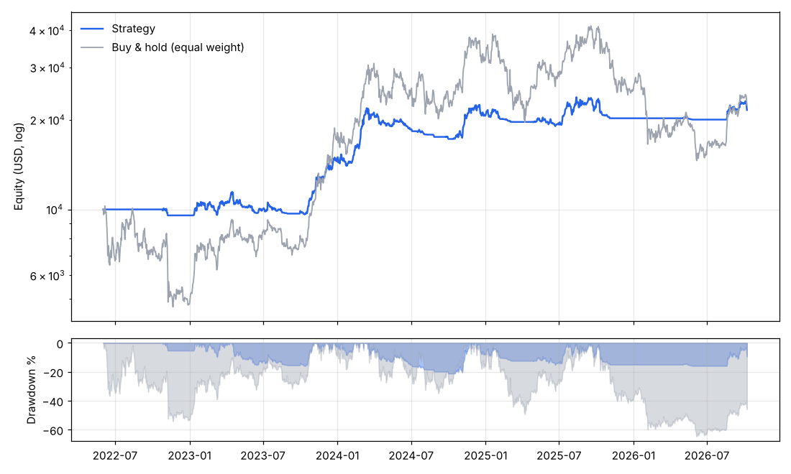

# Bot de trading crypto automatisé

Bot de **suivi de tendance** sur BTC, ETH et SOL (bougies journalières), avec :

- un **backtest** réaliste (frais 0,10 %, slippage 0,05 %, exécution à l'ouverture suivante, sans biais d'anticipation) ;
- un **paper trading** persistant (portefeuille simulé dans `state/`) ;
- un connecteur **Binance spot** (testnet par défaut, réel uniquement sur confirmation explicite) ;
- une **exécution 100 % automatique** chaque jour via GitHub Actions.



## Résultats du backtest (données réelles, juin 2022 → oct. 2026, 10 000 $ de départ)

| | Stratégie | Buy & hold (1/3 chaque) |
|---|---:|---:|
| Rendement total | **+115,9 %** | +123,9 % |
| Rendement annualisé | 19,4 % | 20,4 % |
| Sharpe | **0,95** | 0,61 |
| Drawdown max | **−21,3 %** | −64,7 % |
| Volatilité annuelle | 21 % | 64 % |

Hors période de réglage (**2025-01 → 2026-10**) : stratégie **+4,0 %** (DD −15,9 %) contre **−27,7 %** (DD −63,4 %) pour le buy & hold.

Lecture honnête : le bot ne bat pas le marché en hausse franche, il **évite les krachs**. Il obtient un rendement comparable avec trois fois moins de risque. Un backtest ne garantit rien pour la suite.

## La stratégie

Pour chaque actif, à la clôture de chaque jour :

1. **Score de tendance** : la part des rendements sur 20, 60 et 120 jours qui sont positifs (0, ⅓, ⅔ ou 1).
2. **Filtre de régime** : si le prix est sous sa moyenne mobile 150 jours, la position est mise à 0.
3. **Ciblage de volatilité** : l'exposition est réduite quand l'actif est plus volatil que 40 %/an.
4. Chaque actif dispose d'⅓ du capital. Le reste est en cash (USD/USDT). Pas de levier, pas de vente à découvert.

Les ordres ne partent que si l'écart avec la cible dépasse 3 % du capital, ce qui limite les frais.

Tous les paramètres sont dans [`config.json`](config.json).

## Utilisation

```bash
cd trading-bot
pip install -r requirements.txt

python -m bot update               # télécharge les dernières bougies (Coinbase → Binance → FMP)
python -m bot backtest             # rapport dans reports/ (JSON, CSV, PNG)
python -m bot backtest --start 2025-01-01
python -m bot tick --update        # un cycle de trading (paper par défaut)
python -m bot status               # portefeuille + signaux actuels
python -m pytest -q tests          # tests
```

`tick` est **idempotent** : il ne trade qu'une fois par nouvelle bougie journalière, donc on peut le lancer aussi souvent qu'on veut. Il refuse de trader sur des données vieilles de plus de deux jours.

## Automatisation (GitHub Actions)

Le workflow [`.github/workflows/trading-bot.yml`](../.github/workflows/trading-bot.yml) tourne chaque jour à 00:17 UTC. Il :
1. lance les tests ;
2. télécharge les nouvelles bougies ;
3. exécute `tick` ;
4. commit le journal (`state/trades_*.csv`, `state/equity_*.csv`, `state/portfolio.json`).

Les exécutions planifiées ne démarrent que lorsque le workflow est sur la branche par défaut (`main`). On peut aussi le lancer à la main depuis l'onglet *Actions* (« Run workflow »).

## Passer au testnet, puis au réel

1. Créer des clés sur https://testnet.binance.vision et les ajouter en *secrets* du dépôt : `BINANCE_API_KEY` et `BINANCE_API_SECRET`.
2. Lancer le workflow avec `broker = testnet`, ou en local : `python -m bot tick --broker testnet`.
3. Pour le réel : clés Binance réelles **sans droit de retrait**, variable de dépôt `BINANCE_LIVE=yes`, puis `broker = live`. Sans cette variable, le bot refuse de passer des ordres réels.

> Les runners GitHub sont hébergés aux États-Unis, où `api.binance.com` est bloqué. Pour le trading réel sur Binance, lancez `tick` depuis une machine en Europe (cron, VPS…).

## Avertissement

Ceci est un projet éducatif, pas un conseil en investissement. Les cryptomonnaies sont très volatiles : ne risquez que ce que vous pouvez perdre.
